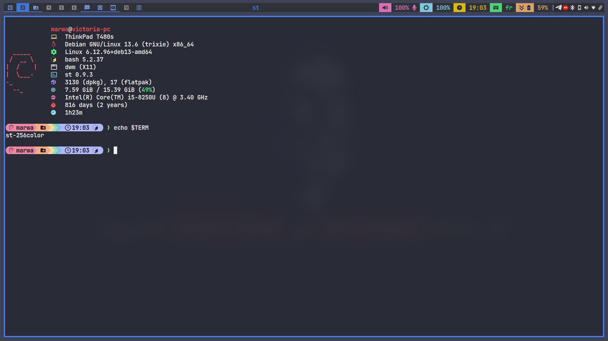

# st

Marwatoo's build of st (simple terminal)



# st - simple terminal

st is a simple terminal emulator for X which sucks less, with a few personal patches and an added autocomplete feature.

## Requirements

In order to build my version of st, you will need:

- libx11-dev
- libxft-dev
- libxext-dev
- build-essential

## Installation

Edit config.mk to match your local setup (st is installed into
the /usr/local namespace by default).

Afterwards enter the following command to build and install st (if
necessary as root):

```
make clean install
```

## Running st

If you did not install st with `make clean install`, you must compile
the st terminfo entry with the following command:

```
tic -sx st.info
```

Once installed, launch it like any other terminal:

```
st
```

See the man page (`st.1`) for additional details and command line options.

## Autocomplete

This build ships with an `st-autocomplete` script for shell-style suggestion completion. See `autocomplete.h` for the relevant configuration.

## Patches

The following patches are applied in this build (see the `patches/` directory):

- **autocomplete** — adds shell-style suggestion autocomplete, paired with the `st-autocomplete` script
- **bidi** — bidirectional text rendering support (e.g. Arabic, Hebrew)
- **clipboard** — binds selection to the system `CLIPBOARD`
- **dracula** — Dracula color scheme
- **drag-n-drop** — drag and drop support for files/text into the terminal
- **font2** — support for a secondary/fallback font
- **fontmetrics** — fixes font metric/rendering glitches
- **scrollback** — adds a scrollback buffer
- **scrollback-mouse** — mouse wheel scrolling through the scrollback buffer
- **xresources** — allows configuration via `.Xresources` instead of recompiling

## Configuration

The configuration of st is done by creating a custom `config.h`
and (re)compiling the source code. `config.mk` controls build-time
options such as install paths and compiler flags.

## Credits

Based on Aurélien APTEL's `<aurelien dot aptel at gmail dot com>` bt source code.
